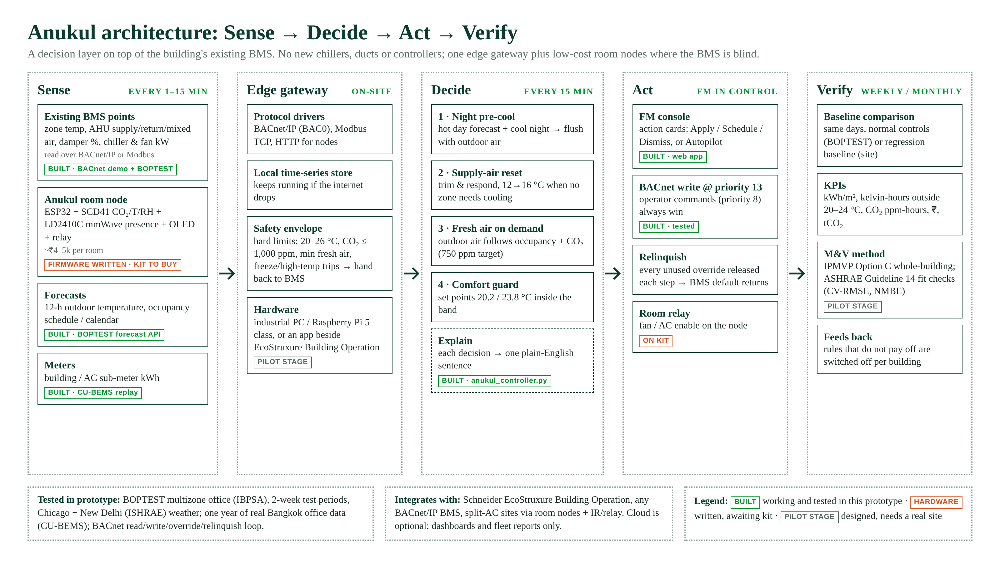
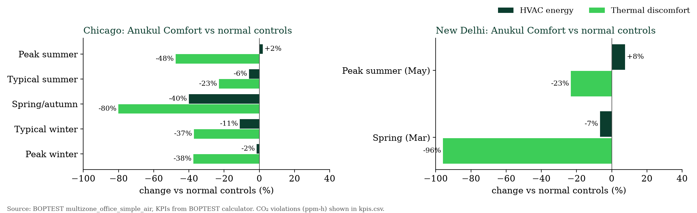

# Anukul — retrofit the intelligence, not the building

Anukul is a decision layer that sits on top of an office building's existing HVAC controls.
Every 15 minutes it **senses** (zone temperature, CO₂, occupancy, weather forecast),
**decides** with four transparent rules, **acts** by writing set points through the building's
own control points (BACnet), and **verifies** the result against the building's normal behaviour.
Every action comes with a plain-English reason a facility manager can approve, schedule or dismiss.

Prototype for the Schneider Electric Yuva Yodha Energy Tech Hackathon, Challenge 02: Smart Buildings.

**Live demo (facility-manager console):** https://praneetha-iift.github.io/anukul-prototype/anukul_control_room.html



## Results at a glance

Tested on **BOPTEST** (IBPSA's open building-control test bench), scored by BOPTEST's own KPI calculator against the building's built-in controls over the same days.

- Five official test periods (Chicago, 14 days each): **Comfort mode** used **4.5% less HVAC energy**, cut **thermal discomfort by 45%**, and cut CO₂ limit exceedance from 100 to 7 ppm·h. **Eco mode** used **7.0% less energy** (45% less in spring/autumn).
- New Delhi weather (ISHRAE 2014): spring saved 7–9% with CO₂ exceedance 376 → 0 ppm·h; in peak summer Anukul used 6–8% more energy because it restored fresh air the normal controls were withholding.
- Real office data (CU-BEMS, Bangkok, 2019): the same rules flag 10–30% of AC energy as avoidable (AC running in empty zones, rooms cooled below 23 °C).



Full numbers: `kpis.csv`.

## Files

| File | What it is |
|---|---|
| `anukul_controller.py` | **The decision engine**: the four rules and a plain-English sentence for every action |
| `runner.py`, `controllers.py`, `pyfmi.py` | Run a BOPTEST scenario locally (no Docker); `pyfmi.py` is a small stand-in for pyfmi built on FMPy |
| `sweep.sh`, `summ.py` | Run several controllers in a batch and summarise KPIs |
| `make_delhi_fmu.py` | Builds a New Delhi version of the BOPTEST office by swapping in ISHRAE-2014 weather |
| `cubems_waste.py`, `cubems_waste.json` | Anukul's Sense/Decide rules over a year of real office data (CU-BEMS) and the results |
| `bacnet_demo.py`, `bacnet_demo_output.txt` | The Act step over real BACnet/IP: read, write at priority 13, operator override (priority 8) wins, relinquish |
| `anukul_node.ino` | ESP32 room-node firmware (SCD41 CO₂ + LD2410C presence + OLED + fan relay). For the Arduino IDE, put it in a folder named `anukul_node` |
| `anukul_control_room.html` | Facility-manager console (the live demo) |
| `template.html`, `export_data.py`, `build.py`, `app_data.json` | How the console is filled with the simulation results |
| `make_results.py`, `kpis.csv`, `results_chart.png` | Results table and chart |
| `architecture.png/.pdf/.html` | Architecture diagram |

## The four rules

| Rule | When it fires | What it changes |
|---|---|---|
| Night pre-cool | 02:00–06:00, hot day forecast (> 24 °C), outdoor ≥ 3 °C cooler than the warmest zone | AHU runs on 100% outdoor air, no mechanical cooling |
| Supply-air reset | Occupied hours | Supply air drifts up from 12 °C (max 16 °C) while no zone asks for cooling; steps down when zones ask; held while CO₂ is high |
| Fresh air on demand | Hot hours, or any time CO₂ passes 750 ppm | Outdoor-air damper follows forecast occupancy + measured CO₂ |
| Comfort guard | Occupied hours (Comfort mode only) | Zone set points 20.2 / 23.8 °C, just inside the 20–24 °C band |

*Eco mode* = the first three rules. *Comfort mode* = all four.

## Running it

Requirements: Linux x86-64, Python 3.11+, `pip install fmpy pandas==2.2.3 numpy scipy pytz matplotlib BAC0`.
BOPTEST: `git clone https://github.com/ibpsa/project1-boptest`. The FMU needs `libgfortran.so.4`
(Ubuntu package `libgfortran4`).

```bash
export BOPTEST_DIR=/path/to/project1-boptest
python runner.py typical_cool_day baseline out_base.json
python runner.py typical_cool_day "anukul:night,dcv,sat" out_eco.json   # Eco
python runner.py typical_cool_day anukul out_comfort.json               # Comfort
python bacnet_demo.py                                                   # BACnet demo on 127.0.0.1
```

Delhi climate: download `IND_DL_New.Delhi-Safdarjung.AP.421820_ISHRAE2014.zip` from climate.onebuilding.org,
run `python make_delhi_fmu.py <path to .epw>`, then use `BOPTEST_CASE=multizone_office_simple_air_delhi`
with scenarios `delhi_peak_cool`, `delhi_monsoon`, `delhi_spring` (`MAX_STEPS` 672, 576, 1056).
The ISHRAE weather file is licensed and is not redistributed here.

Real data: download `2019Floor2.csv` and `2019Floor7.csv` from CU-BEMS (doi:10.6084/m9.figshare.11726517),
then `python cubems_waste.py`.

## Limits of this prototype

- BOPTEST's office has the same occupancy every day, including weekends, so savings from empty weekends and holidays are not counted.
- The Delhi runs keep the Chicago-sized HVAC plant; only the weather changes. The simulation stalls numerically later in some Delhi windows, so Delhi tests are 11 days (spring), 7 days (peak summer) and 6 days (monsoon, Eco only).
- Real-data overcooling savings use BEE's ~6% per °C figure (half of it as the low case); they are estimates. Empty-zone AC energy is measured.
- The ESP32 firmware has not yet been compiled on hardware.
- Code was developed with AI assistance.

## Data and tools credited

BOPTEST (IBPSA Project 1, BSD licence) · CU-BEMS dataset (Pipattanasomporn et al., *Scientific Data* 2020, CC BY 4.0) ·
ISHRAE 2014 weather via climate.onebuilding.org · FMPy · BAC0 / bacpypes3.
